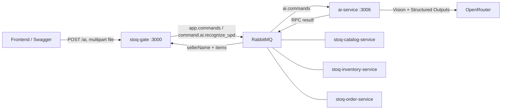

# STOQ backend: gateway и AI Service

`backend/stoq-ai-service` — отдельный NestJS микросервис, пакет `ai-service`. `backend/stoq-gate` — единая HTTP-точка входа. Каталог, склад/поставки и заказы продолжают работать через существующий command bus.

## Как связаны сервисы



Gateway кодирует файл в base64 и отправляет RPC-команду. AI проверяет payload/deadline, декодирует и заново проверяет файл, вызывает OpenRouter и возвращает `{ success, data }` либо безопасный `{ success: false, error }`. Gateway валидирует результат и возвращает клиенту `{ sellerName, items }` без RPC-обёртки. Ключ OpenRouter хранится только в AI-сервисе.

## Локальный запуск на Windows

Нужны Node.js 22.19+, RabbitMQ и настроенный OpenRouter ключ. Настройки ключа и Happ перенесены в `backend/stoq-ai-service/.env`. Секреты не входят в Git.

1. В `backend/stoq-gate/.env` и `backend/stoq-ai-service/.env` задайте одинаковый `RABBITMQ_URL` вашего брокера. AI: `PORT=3006`, `RABBITMQ_ENABLED=true`; gateway: `PORT=3000`, `AI_RPC_TIMEOUT_MS=150000`, `AI_MAX_FILE_SIZE_MB=20`.
2. Установите зависимости:

```powershell
cd C:\Users\Lyaguh\Desktop\stoq-backend
npm ci --prefix backend/stoq-ai-service
npm ci --prefix backend/stoq-gate
```

3. Запустите в двух терминалах из корня:

```powershell
npm run ai:dev
# Второй терминал:
npm run gate:dev
```

Swagger gateway: http://127.0.0.1:3000/api. Загрузка: **POST /ai → Try it out → file → Execute**.
Swagger AI: http://127.0.0.1:3006/docs. Прямой маршрут: **POST /ai**.
Проверка через брокер: **GET http://127.0.0.1:3000/ai/health**. Проверка HTTP-процесса worker: **GET http://127.0.0.1:3006/ai/health**. OpenRouter на health не вызывается.

## Контракт результата

```json
{
  "sellerName": "ООО Молочный двор",
  "items": [
    {
      "name": "Молоко",
      "quantity": 2,
      "price": 612,
      "totalPrice": 1224,
      "unit": "шт"
    }
  ]
}
```

Все прежние правила распознавания сохранены: quantity из буквального текста графы 3; price из графы 4; totalPrice из графы 9; цены независимо округляются до рубля; sellerName очищается от кавычек; неизвестные поля — null. Полная документация — `backend/stoq-ai-service/README.md`.

`POST /ai` только распознаёт документ и сохраняет прежний контракт. Для заполнения формы поставки используется `POST /ai/supply` (то же multipart-поле `file`). Gateway сначала выполняет прежнюю AI-команду, затем `command.catalog.resolve_upd_products`. Каталог использует прежние `ProductRPCController`, `RabbitRPC`, очередь `catalog.commands` и `executeRpc`; механизм RabbitMQ, очереди и exchange не изменены.

`POST /ai/supply` ищет товары по полному нормализованному названию, создаёт отсутствующие товары и читаемые единицы измерения и исключает строки доставки. Разные названия не объединяются по смыслу. Ответ:

```json
{
  "sellerName": "ООО Молочный двор",
  "items": [{
    "productId": 42,
    "name": "Молоко питьевое 3,2%, 1 л",
    "quantity": 24,
    "price": 95,
    "totalPrice": 2508,
    "unit": { "id": 1, "name": "Штука", "shortName": "шт" }
  }]
}
```

Нечитаемые количество/цены остаются `null`. Нечитаемое название/единица, удалённый товар и несовместимая единица дают HTTP 422 без частичного сохранения каталога. Импорт каталога выполняется в одной транзакции; PostgreSQL advisory-lock предотвращает дубли между одновременными сканированиями. Миграции БД не нужны. Каталог сохраняется при сканировании; поставка создаётся отдельно после проверки формы пользователем. Номер поставки и сроки годности вводятся вручную.

Для включения сценария обновите и перезапустите **gateway и catalog-service**, используя общий существующий RabbitMQ. AI worker продолжает распознавать по прежней команде. Таймаут catalog-команды — 30 секунд, frontend запроса — 210 секунд.

## RPC из других сервисов

В топологии gateway, каталога, склада и заказов зарегистрированы:

- `EXCHANGES.COMMANDS = app.commands`;
- `ROUTING_KEYS.RECOGNIZE_UPD = command.ai.recognize_upd`, очередь `ai.commands`;
- `ROUTING_KEYS.AI_HEALTH = command.ai.health`, очередь `ai.health`.

Пример с существующим CommandBusService:

```typescript
const timeoutMs = 150_000;
const result = await commandBusService.sendCommand(
  EXCHANGES.COMMANDS,
  ROUTING_KEYS.RECOGNIZE_UPD,
  {
    file: {
      originalname: file.originalname,
      mimetype: file.mimetype,
      base64: file.buffer.toString("base64"),
    },
    deadlineAt: Date.now() + timeoutMs,
  },
  { timeoutMs },
);
if (!result.success) throw new Error(result.error.message);
const { sellerName, items } = result.data;
```

Обычные RPC-вызовы сохраняют таймаут 5 секунд. Для AI задаётся отдельный timeout и TTL сообщения, превышающий OpenRouter timeout (120 сек по умолчанию). Deadline не позволяет запускать inference для команд, срок ожидания которых уже истёк. Таймаут RPC не отменяет уже начавшееся распознавание; автоматические retries отключены.

Файл 20 MiB увеличивается примерно до 27 MiB в base64. На брокере нужен `max_message_size` не меньше 32 MiB; конфигурация есть в `docker/rabbitmq/rabbitmq.conf`. Проверки лимитов выполняются в gateway до отправки и в worker до inference. Брокер, gateway и worker должны работать в доверенной сети; политики доступа остальных endpoint не менялись.

## Docker Compose

`compose.ai.yaml` запускает RabbitMQ, gateway и AI. Остальные сервисы подключаются к этому же брокеру своим `RABBITMQ_URL`.

```powershell
docker compose -f compose.ai.yaml up --build -d
```

Если брокер уже работает, не запускайте второй на тех же портах: используйте существующий RabbitMQ для Node-процессов или подключите сервисы к его сети/адресу. Локальный пример по умолчанию использует admin/admin; свои учетные данные передаются через `RABBITMQ_USER` и `RABBITMQ_PASSWORD`.

В контейнере localhost означает контейнер. Для Happ на Windows-хосте задайте `AI_DOCKER_PROXY_URL=http://host.docker.internal:10809` и разрешите необходимые подключения в Happ. Текущий рабочий вариант на этом ПК — Node-процесс AI через `AI_PROXY_URL=http://127.0.0.1:10809`, без TUN. Gateway и другие сервисы не используют этот прокси.

## Проверки

```powershell
npm run build:ai
npm run test:ai
```

Для end-to-end теста нужен **отдельный** брокер на 5677:

```powershell
$env:RABBITMQ_PORT='5677'
$env:RABBITMQ_MANAGEMENT_PORT='15677'
docker compose -f compose.ai.yaml -p stoq-ai-integration up -d rabbitmq
npm run test:ai-integration
docker compose -f compose.ai.yaml -p stoq-ai-integration stop rabbitmq
```

Тест использует настоящий RabbitMQ и HTTP gateway/worker, но подменяет OpenRouter. Проверяет PNG, PDF, health, сохранение ошибок, округление и обработку дольше старых 5 секунд. Реальный ключ, баланс и платный inference не используются.

## Старое расположение

`C:\Users\Lyaguh\Desktop\stoq-ml` — совместимая командная обёртка. Ее `npm run start:dev` запускает новый AI в самостоятельном HTTP-режиме без RabbitMQ. Основные исходники и `.env` теперь находятся в `backend/stoq-ai-service`; прежний checkout сохранен локально в `stoq-ml/legacy-source`.

Если ваш frontend обращается к backend на другом компьютере (например, 26.130.106.197:3000), на том компьютере нужно запустить обновленный gateway и подключенный AI worker с общим брокером. Локальное изменение репозитория не обновляет удаленный процесс автоматически.

## Поставки, склад, блюда и заказы

Новые денежные поля поставок, цены партий, категории и складские показатели блюд, дата ISO и реквизиты заказов описаны в [docs/business-fields.md](docs/business-fields.md). Там же находятся порядок миграций, примеры POST и команды проверки.

## Цены заказов

Заказ возвращает `totalPrice`, а каждая позиция — `name`, `imageURL`, `price` и `totalPrice`. Цена и название сохраняются при добавлении из существующего RPC каталога `GET_DISHES_BY_ID`. Изменение текущего меню не меняет историческую стоимость заказа. Пустой заказ имеет сумму 0; для старых позиций без цены денежные поля и итог заказа остаются `null`. Неизвестная цена продажи не позволяет добавить новую позицию.

Перед запуском обновлённого order-service примените добавочную миграцию `20261013120000_order_item_prices` к его БД, затем сгенерируйте клиент и соберите сервис из каталога `backend/stoq-order-service`:

```powershell
npx prisma migrate deploy
npx prisma generate
npm run build
```

Затем пересоберите и перезапустите gateway и order-service. Схема RabbitMQ и существующие routing keys не меняются. Миграция не восстанавливает старые цены из нынешнего меню.

Проверки: `npm --prefix backend/stoq-order-service test -- --runInBand`, `npm run test:business-integration` (только отдельные локальные PostgreSQL 55434 и RabbitMQ 5678).

## Граф зависимостей

`GET /analytics/graph` возвращает ровно `{ nodes, edges }`: ингредиенты с ID `product:<id>`, блюда `dish:<id>`, связи `recipe:<id>`. Gateway проксирует команду `GET_DEPENDENCY_GRAPH` (`command.recommendation.get_dependency_graph`) в существующую очередь `recommendation.commands`. Recommendation-service получает данные через существующую команду каталога `GET_DISHES` и рассчитывает граф. Конфигурация RabbitMQ, очереди, exchanges, CommandBusService и формат `{ success, data/error }` сохраняются. В граф входят активные блюда и ингредиенты их составов.

`quantity` — пригодный доступный складской остаток, `required` — расход на одну порцию; оба в единице продукта `unit.shortName`. Просроченные, недоступные и зарезервированные остатки не увеличивают доступный запас.

Статусы рассчитываются в recommendation-service для каждой связи отдельно: меньше одной порции — `unavailable`, 1–5 порций включительно — `low_stock`, больше 5 — `available`. При нулевом остатке ингредиент — `out_of_stock`; при положительном остатке его статус учитывает наиболее требовательный рецепт. Блюдо получает худший статус своей связи, а без состава — `unavailable`. Порог задаётся `DEPENDENCY_GRAPH_LOW_STOCK_PORTIONS` в recommendation-service, по умолчанию 5.

Пустой каталог возвращает пустые массивы. Ошибка каталога/склада сохраняет HTTP-статус; недоступный брокер — 503, некорректные данные — 502. Swagger описывает оба типа узлов и статусы. Для запуска пересоберите и перезапустите **gateway и recommendation-service**, подключённые к одному существующему брокеру. Дополнительные миграции для графа не нужны. Старый API-путь `/analytics/dependencies` удалён; frontend использует `/analytics/graph`.
